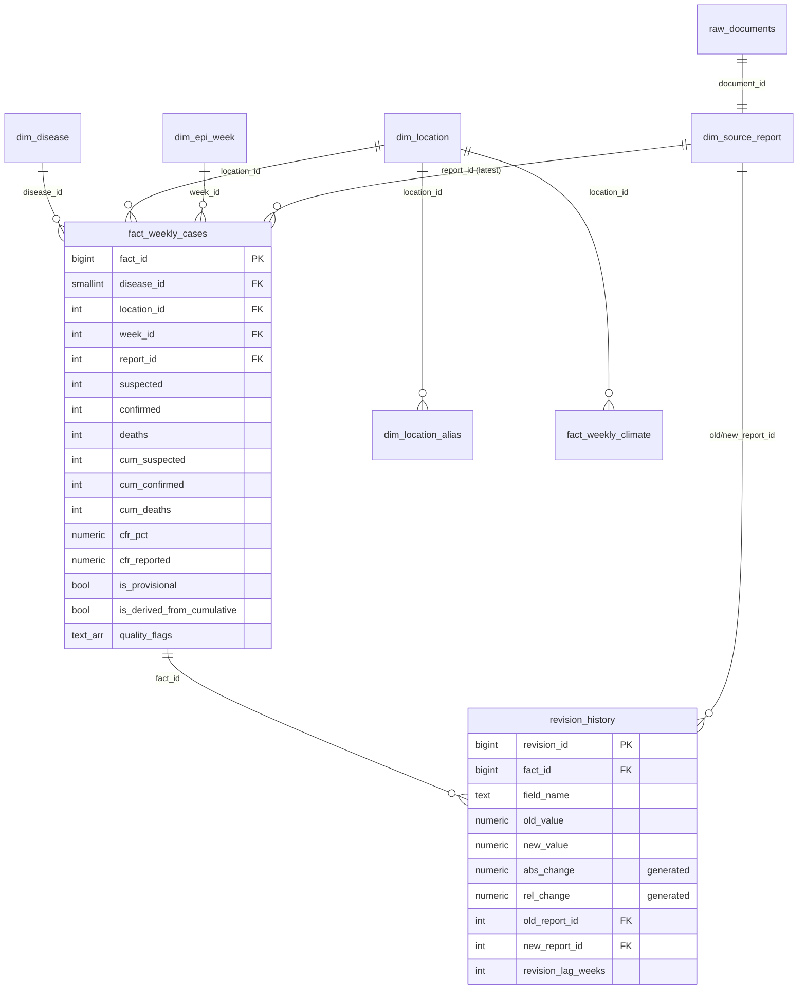

# Database schema

`src/storage/schema.sql` is the single source of truth. It is idempotent, so it
can be re-run on an existing database. `src/storage/models.py` mirrors it for
ORM use, and `tests/integration/test_schema_models.py` fails if they drift.

## Schemas (storage zones)

| Schema      | Purpose | Tables |
|-------------|---------|--------|
| `ops`       | Orchestration, monitoring, data quality | `pipeline_run_log`, `validation_rule`, `quarantine`, `data_quality_flag` |
| `raw`       | Immutable register of downloaded files | `documents` |
| `staging`   | Validated rows awaiting merge (natural keys) | `weekly_cases` |
| `curated`   | Star schema + audit trail (+ views `v_weekly_cases`) | `fact_weekly_cases`, `fact_weekly_climate`, `dim_disease`, `dim_location`, `dim_location_alias`, `dim_epi_week`, `dim_source_report`, `revision_history` |
| `analytics` | Model outputs | `stl_component`, `forecast`, `model_evaluation`, `alert` |

## Star schema (curated layer)



Grain of `fact_weekly_cases`: **one row per disease × location × epidemiological
week** (`uq_fact_grain`). `report_id` always points at the most recent report.

## Key design decisions

1. **`week_id = epi_year * 100 + epi_week`** (e.g. `202405`). Readable,
   sortable and verified by CHECK constraints against ISO 8601
   (`week_start` must be the Monday of that ISO week).
2. **Revision capture is a database trigger** (`trg_fact_revision`). Any UPSERT
   that changes a measure writes one `revision_history` row per changed field
   with the old and new report IDs, so application code cannot skip the audit
   trail. Set `pipeline.run_id` per transaction (done by
   `db.report_transaction`) to stamp the run.
3. **NULL is never coerced to 0.** Every count is nullable; a row must carry at
   least one figure (`ck_fact_has_value`).
4. **Incidence is computed in `curated.v_weekly_cases`**, not stored, so it
   stays correct when population figures are updated.
5. **`is_provisional`** is refreshed after each load by
   `curated.refresh_provisional_flags()` (latest 4 weeks per disease).
6. **Merge rules**: a value missing from a new report never erases a stored
   value (`COALESCE`), and a report for an earlier week never overwrites
   figures from a later report.
7. **`is_synthetic`** on `raw.documents` and `dim_source_report` marks demo
   data; the dashboard shows a banner while any exists.

## Validation rules enforced in the database (Table 3.4)

| Rule | Python layer | Database backstop |
|------|--------------|-------------------|
| R1 schema / types | ✔ | column types, NOT NULL |
| R2 non-negative counts | ✔ | `CHECK (x IS NULL OR x >= 0)` |
| R3 confirmed ≤ suspected | ✔ | `ck_confirmed_le_suspected` |
| R4 deaths ≤ CFR denominator | ✔ exact, per disease | `ck_deaths_le_cases` (≤ larger case count) |
| R5 CFR within 0.1 pp | ✔ warning | `cfr_* BETWEEN 0 AND 100` |
| R6 YTD not decreasing | ✔ warning | revision trigger records it |
| R7 states sum to national | ✔ warning | — |
| R8 epi week 1–53, dates match | ✔ | `dim_epi_week` checks + FK |
| R9 location in HDX list | ✔ | FK to `dim_location`, `resolve_location()` |
| R10 one row per grain | ✔ | `uq_fact_grain`, `uq_staging_grain` |
| R11 timeliness ≤ 14 days | ✔ warning | — |
| R12 completeness | ✔ warning | — |

Warning-level results are written to `ops.data_quality_flag`; error-level
failures go to `ops.quarantine` with the `rule_id` and the offending row as JSON.

## Helper functions

| Function | Use |
|----------|-----|
| `curated.populate_epi_weeks(from, to)` | Fill the week calendar (seeded 2020–2027) |
| `curated.resolve_location(name)` | Alias lookup, case/space-insensitive; NULL → rule 9 |
| `curated.refresh_provisional_flags(n)` | Mark the latest *n* weeks provisional |

## Testing the schema

```bash
psql "$DATABASE_URL" -v ON_ERROR_STOP=1 -f src/storage/schema.sql
psql "$DATABASE_URL" -v ON_ERROR_STOP=1 -f tests/integration/sql/schema_smoke_test.sql
# -> NOTICE: schema smoke test: ALL CHECKS PASSED
TEST_DATABASE_URL=postgresql+psycopg://... pytest tests/integration
```
