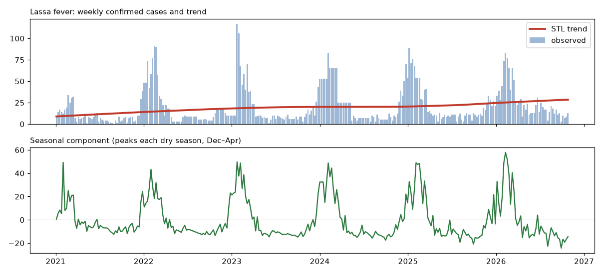
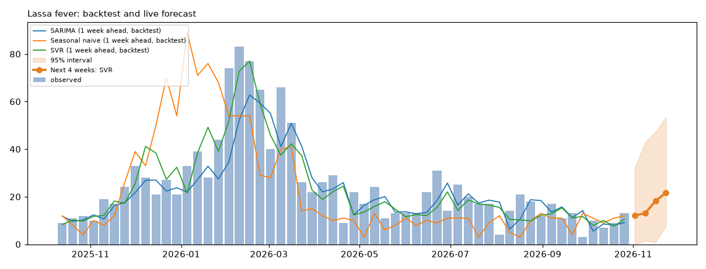

# Results

> **Real NCDC data, as of 19 November 2026.** Figures were read automatically from the Nigeria Centre for Disease Control and Prevention's situation reports and checked by the pipeline's validation rules. The four most recent weeks may still be revised by later reports. No synthetic (demo) data is included.

Generated by the *Results report* workflow after each database load. 658 figures for 7 diseases, 04 Jan 2021 – 26 Oct 2026.

## 0. What is in the database

| disease | first_week | last_week | weeks | reports |
|---|---|---|---|---|
| Cerebrospinal meningitis | 29 May 2023 | 31 Mar 2025 | 7 | 7 |
| Cholera | 19 Jul 2021 | 24 Feb 2025 | 67 | 67 |
| Diphtheria | 27 Nov 2023 | 12 Jan 2026 | 14 | 14 |
| Lassa fever | 04 Jan 2021 | 26 Oct 2026 | 238 | 238 |
| Measles | 30 Jun 2025 | 28 Sep 2026 | 16 | 16 |
| Mpox | 24 May 2021 | 28 Oct 2024 | 77 | 77 |
| Yellow fever | 25 Jan 2021 | 26 May 2025 | 40 | 40 |

## 1. Pipeline runs (RQ1)

Most recent 12 runs:

| started_at | run_type | status | files_new | rows_extracted | rows_passed | rows_warned | rows_quarantined | revisions_detected | seconds |
|---|---|---|---|---|---|---|---|---|---|
| 2026-11-19 10:34 | manual | partial | 13 | 11283 | 10878 | 389 | 360 | 2059 | 1513 |
| 2026-11-19 10:07 | backfill | partial | 892 | 331 | 283 | 31 | 48 | 0 | 5474 |
| 2026-11-19 09:34 | backfill | success | 21 | 21 | 20 | 4 | 1 | 0 | 218 |

## 2. Data quality

Rows held back for review (quarantine), by the rule that stopped them:

| rule | rows_held_back | example |
|---|---|---|
| parse | 266 | parse failure: could not read the epidemiological week/year from the title page ('Nigeria Centre for Disease Control') |
| R09_LOCATION | 256 | location 'Abia ▼ 4 1' not in the HDX reference list |
| R02_NON_NEGATIVE | 80 | cum_confirmed fell from 10 to 2.0; weekly confirmed would be -8 |
| R03_CONFIRMED_LE_SUSP | 4 | confirmed (10) > suspected (3.0) |
| R04_DEATHS_LE_CASES | 2 | deaths (6) > confirmed (1.0) |
| R08_EPI_WEEK | 1 | printed dates 2020-12-27–2021-01-02 do not match ISO 2021-W52 (2021-12-27–2022-01-02) |

Warnings (row loaded, but flagged):

| flag_type | n |
|---|---|
| R12_COMPLETENESS | 3710 |
| R06_CUM_DECREASE | 99 |
| R05_CFR_MISMATCH | 25 |
| R07_STATE_SUM | 19 |

## 3. Revisions detected (RQ2)

5 figures were changed by later reports. First 15:

| disease_name | location | epi_year | epi_week | field_name | old_value | new_value | revision_lag_weeks |
|---|---|---|---|---|---|---|---|
| Lassa fever | Nigeria | 2021 | 33 | suspected | 83 | 58 | 0 |
| Lassa fever | Nigeria | 2021 | 33 | confirmed | 9 | 2 | 0 |
| Lassa fever | Nigeria | 2021 | 33 | cum_suspected | 2876 | 2793 | 0 |
| Lassa fever | Nigeria | 2021 | 33 | cum_confirmed | 365 | 356 | 0 |
| Lassa fever | Nigeria | 2021 | 33 | cum_deaths | 99 | 73 | 0 |

## 4. Trends (RQ3)

## 5. Outbreak alerts (RQ3)

176 weeks crossed an alert threshold. Most recent 15:

| method | disease_name | location | week_start | observed | expected | statistic |
|---|---|---|---|---|---|---|
| SARIMA_RESID_Z | Lassa fever | Nigeria | 2026-03-09 | 66.0 | 41.5 | 2.1 |
| EARS_C3 | Lassa fever | Nigeria | 2026-03-02 | 40.0 | 46.0 | 4.8 |
| EARS_C3 | Lassa fever | Nigeria | 2026-02-23 | 65.0 | 38.0 | 12.4 |
| EARS_C3 | Lassa fever | Nigeria | 2026-02-16 | 77.0 | 30.4 | 17.7 |
| EARS_C2 | Lassa fever | Nigeria | 2026-02-16 | 77.0 | 30.4 | 5.3 |
| EARS_C3 | Lassa fever | Nigeria | 2026-02-09 | 83.0 | 28.1 | 15.8 |
| EARS_C2 | Lassa fever | Nigeria | 2026-02-09 | 83.0 | 28.1 | 8.6 |
| SARIMA_RESID_Z | Lassa fever | Nigeria | 2026-02-09 | 83.0 | 51.2 | 2.7 |
| EARS_C3 | Lassa fever | Nigeria | 2026-02-02 | 74.0 | 28.9 | 8.2 |
| EARS_C2 | Lassa fever | Nigeria | 2026-02-02 | 74.0 | 28.9 | 6.8 |
| EARS_C1 | Lassa fever | Nigeria | 2026-02-02 | 74.0 | 30.4 | 5.0 |
| SARIMA_RESID_Z | Lassa fever | Nigeria | 2026-02-02 | 74.0 | 34.4 | 3.5 |
| EARS_C3 | Lassa fever | Nigeria | 2026-01-26 | 44.0 | 26.7 | 4.1 |
| EARS_C2 | Lassa fever | Nigeria | 2026-01-26 | 44.0 | 26.7 | 3.4 |
| EARS_C3 | Diphtheria | Nigeria | 2026-01-12 | 34.0 | 52.4 | 9.2 |

## 5b. Lassa fever by state

Confirmed cases so far in 2026 (Table 3 of the latest report, read by OCR and checked against the national total). Top 10:

| state | confirmed 2026 | per 100,000 |
|---|---|---|
| Bauchi | 12.00 |  |
| Ondo | 6.00 |  |
| Edo | 3.00 |  |

## 6. Lassa fever forecasting (RQ4)

Rolling-origin evaluation over 55 forecast origins. Best 1-week model: **SVR**.

| model | MASE 1 wk | MASE 2 wk | MASE 3 wk | MASE 4 wk |
|---|---|---|---|---|
| SVR | 0.557 | 0.632 | 0.715 | 0.755 |
| Negative binomial | 0.602 | 0.713 | 0.760 | 0.798 |
| SARIMA | 0.619 | 0.711 | 0.793 | 0.861 |
| Random Forest | 0.631 | 0.722 | 0.742 | 0.691 |
| Gradient Boosting | 0.657 | 0.739 | 0.836 | 0.833 |
| XGBoost | 0.706 | 0.762 | 0.802 | 0.757 |
| Seasonal naive | 1.093 | 1.109 | 1.125 | 1.134 |

Diebold-Mariano test against SARIMA, 1 week ahead (negative = more accurate than SARIMA; p < 0.05 = significant):

| model_name | mae | rmse | mase | dm_statistic | dm_p_value |
|---|---|---|---|---|---|
| Gradient Boosting | 7.965 | 10.048 | 0.657 | -0.477 | 0.635 |
| Negative binomial | 7.300 | 9.656 | 0.602 | -1.007 | 0.318 |
| Random Forest | 7.653 | 9.529 | 0.631 | -0.752 | 0.456 |
| Seasonal naive | 13.255 | 18.254 | 1.093 | 2.577 | 0.013 |
| SVR | 6.753 | 9.150 | 0.557 | -1.110 | 0.272 |
| XGBoost | 8.556 | 10.687 | 0.706 | -0.017 | 0.986 |

