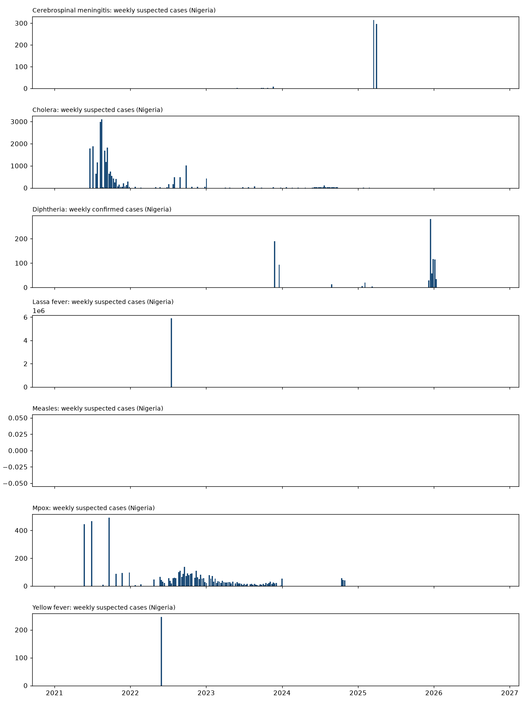
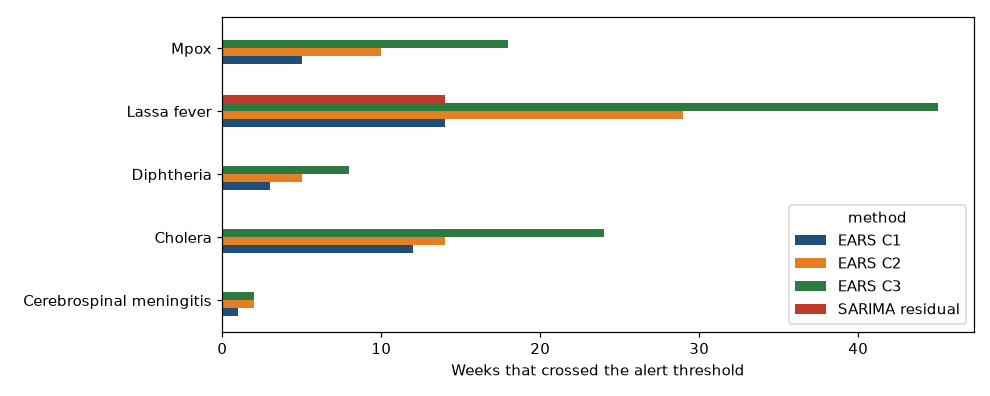
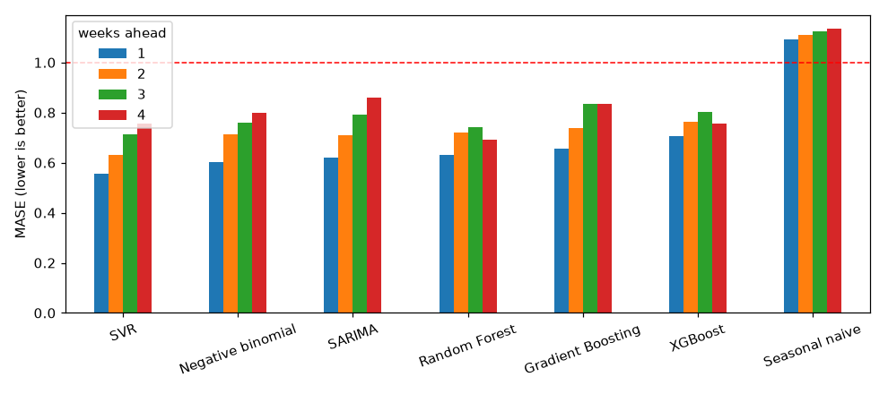
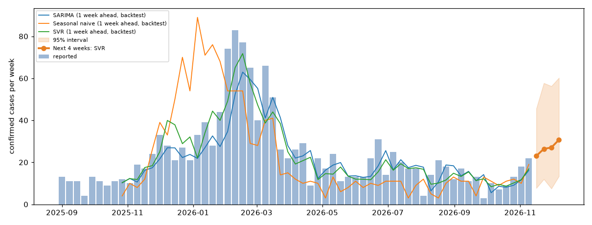

# Results

> **Real NCDC data, as of 26 November 2026.** All figures were read automatically from the situation reports of the Nigeria Centre for Disease Control and Prevention (NCDC) and checked by the pipeline's validation rules. The four most recent weeks may still be revised by later reports. No synthetic (demo) data is included.

This page is rebuilt automatically after every database load, so every number below comes from the database at the time of writing. The research questions (RQ1 to RQ4) are the ones in the thesis.

## 1. Data collected

The pipeline downloaded 915 NCDC report files. It read 522 of them automatically, set aside 248 (mostly reports from before the 2021 to 2026 study period) and sent 131 to the manual queue because their layout could not be read with confidence. Table 1 shows what was stored for each disease. Lassa fever had the most complete record, with 239 weeks. This is because NCDC publishes a Lassa fever report almost every week, while the other diseases are reported in short runs during outbreaks or once a month.

Table 1- National figures stored for each disease

| Disease | First week | Last week | Weeks | Weekly figures |
|---|---|---|---|---|
| Cerebrospinal meningitis | 29 May 2023 | 31 Mar 2025 | 8 | yes |
| Cholera | 29 Mar 2021 | 24 Feb 2025 | 77 | yes |
| Diphtheria | 27 Nov 2023 | 12 Jan 2026 | 14 | yes |
| Lassa fever | 04 Jan 2021 | 09 Nov 2026 | 239 | yes |
| Measles | 30 Jun 2025 | 28 Sep 2026 | 16 | yes |
| Mpox | 24 Jan 2022 | 28 Oct 2024 | 105 | yes |
| Yellow fever | 25 Jan 2021 | 26 May 2025 | 40 | yes |


## 2. Pipeline runs (RQ1)

Out of 10 recorded runs, 6 finished successfully, 4 finished partly (the run completed but at least one report could not be read or loaded) and 0 failed. A partial run still saves everything it could read, and the reports it could not read are listed for review.

Table 2- The ten most recent pipeline runs

| Started (UTC) | Type | Status | New files | Rows read | Rows loaded | Rows flagged | Rows held back | Revisions | Seconds |
|---|---|---|---|---|---|---|---|---|---|
| 2026-11-26 15:18 | daily_check | success | 0 | 0 | 0 | 0 | 0 | 0 | 81 |
| 2026-11-26 08:50 | manual | success | 0 | 0 | 0 | 0 | 0 | 0 | 206 |
| 2026-11-25 15:38 | daily_check | success | 2 | 39 | 39 | 0 | 0 | 0 | 174 |
| 2026-11-23 16:00 | scheduled | success | 0 | 0 | 0 | 0 | 0 | 0 | 207 |
| 2026-11-19 18:31 | manual | success | 0 | 1 | 0 | 0 | 1 | 0 | 272 |
| 2026-11-19 17:31 | manual | partial | 0 | 311 | 307 | 27 | 4 | 7 | 1977 |
| 2026-11-19 13:17 | manual | partial | 0 | 5732 | 5439 | 84 | 293 | 17 | 15154 |
| 2026-11-19 10:34 | manual | partial | 13 | 11283 | 10878 | 389 | 360 | 2059 | 1513 |
| 2026-11-19 10:07 | backfill | partial | 892 | 331 | 283 | 31 | 48 | 0 | 5474 |
| 2026-11-19 09:34 | backfill | success | 21 | 21 | 20 | 4 | 1 | 0 | 218 |


## 3. Data quality

432 items are waiting for review in quarantine (a holding area for anything that fails a check, so it never reaches the dashboard). 134 of them are whole reports that could not be read with confidence, and 298 are single figures that broke a validation rule. Table 3 shows which rule stopped them. When a report is read again, its earlier entries are closed and only the new result is kept, so each item is counted once (607 earlier entries have been closed this way or because the report was later read successfully). Figures that passed but looked unusual were loaded with a warning flag instead (Table 4).

Table 3- Rows held back, by rule

| Rule | Rows held back | Example reason |
|---|---|---|
| R09_LOCATION | 256 | location 'Abia ▼ 4 1' not in the HDX reference list |
| parse | 134 | parse failure: could not read the epidemiological week/year from the title page ('Nigeria Centre for Disease Control') |
| R04_DEATHS_LE_CASES | 30 | cum_deaths (2) > cum_confirmed (1) |
| R02_NON_NEGATIVE | 10 | cum_confirmed is not a whole number: '5990 867 37' |
| R03_CONFIRMED_LE_SUSP | 1 | confirmed (10) > suspected (5) |
| R08_EPI_WEEK | 1 | printed dates 2020-12-27–2021-01-02 do not match ISO 2021-W52 (2021-12-27–2022-01-02) |


Table 4- Warnings on loaded rows

| Warning | Rows |
|---|---|
| R12_COMPLETENESS | 6771 |
| R07_STATE_SUM | 154 |
| R06_CUM_DECREASE | 130 |
| R05_CFR_MISMATCH | 50 |


## 4. Revisions (RQ2)

Later reports changed 29 figures that had already been stored. The median revision lag (the number of weeks between the first report and the correction) was 0 weeks, which means most corrections came in a second report for the same week. Every change is kept in the revision history table with the old value, the new value and both source reports.

Table 5- Revisions by disease

| Disease | Revisions | Median lag (weeks) |
|---|---|---|
| Cholera | 2 | 0.0 |
| Lassa fever | 22 | 0.0 |
| Mpox | 5 | 0.0 |


## 5. Trends (RQ3)

Fig. 1 shows the weekly national figures for every disease with at least three reported weeks. Each disease is shown with the measure it is analysed with: Cerebrospinal meningitis as suspected cases, Cholera as suspected cases, Diphtheria as confirmed cases, Lassa fever as confirmed cases, Mpox as suspected cases. Gaps are weeks with no published report, not weeks with zero cases.



Fig. 1- Weekly national cases by disease. Source: Collins C. Akagha (2026), using NCDC situation reports.

I split the Lassa fever series into a trend and a seasonal pattern with STL (Seasonal-Trend decomposition using Loess). The seasonal pattern is highest in February, which matches the dry-season peak that NCDC describes every year (Fig. 2).


Fig. 2- Lassa fever trend and seasonal pattern (STL). Source: Collins C. Akagha (2026).

## 6. Outbreak alerts (RQ3)

I ran the EARS C1, C2 and C3 checks (simple statistical tests from the US CDC's Early Aberration Reporting System that compare a week with the weeks before it) on every national series, and a SARIMA residual check on every series with more than two years of weekly data. Together they flagged 206 weeks out of 1,570 checks (Fig. 3).



Fig. 3- Weeks flagged by each alert method. Source: Collins C. Akagha (2026).

Table 6- Alert checks by disease and method

| Disease | Method | Alerts | Weeks checked |
|---|---|---|---|
| Cerebrospinal meningitis | EARS C1 | 1 | 7 |
| Cerebrospinal meningitis | EARS C2 | 2 | 7 |
| Cerebrospinal meningitis | EARS C3 | 2 | 7 |
| Cholera | EARS C1 | 12 | 71 |
| Cholera | EARS C2 | 14 | 71 |
| Cholera | EARS C3 | 24 | 71 |
| Cholera | SARIMA residual | 0 | 44 |
| Diphtheria | EARS C1 | 3 | 12 |
| Diphtheria | EARS C2 | 5 | 12 |
| Diphtheria | EARS C3 | 8 | 12 |
| Lassa fever | EARS C1 | 14 | 233 |
| Lassa fever | EARS C2 | 29 | 231 |
| Lassa fever | EARS C3 | 45 | 229 |
| Lassa fever | SARIMA residual | 14 | 195 |
| Mpox | EARS C1 | 5 | 94 |
| Mpox | EARS C2 | 10 | 94 |
| Mpox | EARS C3 | 18 | 94 |
| Mpox | SARIMA residual | 0 | 86 |


## 7. Forecasting (RQ4)

I compared seven forecasting methods: a seasonal naive benchmark (the same week last year), SARIMA, a negative binomial regression, Random Forest, Gradient Boosting, XGBoost and support vector regression (SVR). Each method was tested with a rolling origin (it forecasts 1 to 4 weeks ahead from a point in the past, using only the data that existed at that point, then the point moves forward one week). Accuracy is reported as MAE (mean absolute error, in cases), RMSE (root mean squared error) and MASE (the error divided by the error of the seasonal naive benchmark, so a value below 1 means the method beat it). I used the Diebold-Mariano test (a test of whether two sets of forecast errors are really different) with the Harvey-Leybourne-Newbold correction for small samples to compare each method with SARIMA.

### Lassa fever

The models were trained on confirmed cases. Each was tested over 55 forecast origins. One week ahead, the most accurate method was **SVR** with a MASE of 0.594 and an average error of 7.2 cases per week. The next best was Negative binomial (MASE 0.606), so the best method was 1.9% more accurate. For comparison, SARIMA scored 0.636 and the seasonal naive benchmark scored 1.109. 6 of the 7 methods beat the seasonal naive benchmark one week ahead.



Fig. 4- Lassa fever: MASE by method and forecast horizon (the red line marks the seasonal naive benchmark). Source: Collins C. Akagha (2026).

Table 7- Lassa fever: MASE by method and weeks ahead

| Method | MASE 1 wk | MASE 2 wk | MASE 3 wk | MASE 4 wk |
|---|---|---|---|---|
| SVR | 0.594 | 0.685 | 0.722 | 0.792 |
| Negative binomial | 0.606 | 0.722 | 0.763 | 0.808 |
| SARIMA | 0.636 | 0.740 | 0.831 | 0.886 |
| Random Forest | 0.650 | 0.741 | 0.765 | 0.701 |
| Gradient Boosting | 0.665 | 0.715 | 0.753 | 0.788 |
| XGBoost | 0.700 | 0.704 | 0.725 | 0.809 |
| Seasonal naive | 1.109 | 1.117 | 1.138 | 1.142 |


At the 5% level, the Diebold-Mariano test showed that Seasonal naive (p = 0.013) was significantly less accurate than SARIMA. For the other methods the difference from SARIMA could be due to chance, so I cannot say that any of them is truly better or worse than SARIMA.

Table 8- Lassa fever: one-week-ahead accuracy and Diebold-Mariano test against SARIMA

| Method | MAE | RMSE | MASE | DM statistic | p-value |
|---|---|---|---|---|---|
| SVR | 7.153 | 9.289 | 0.594 | -1.282 | 0.205 |
| Negative binomial | 7.294 | 9.656 | 0.606 | -1.054 | 0.297 |
| Random Forest | 7.829 | 9.592 | 0.650 | -0.744 | 0.460 |
| Gradient Boosting | 8.002 | 10.073 | 0.665 | -0.474 | 0.638 |
| XGBoost | 8.421 | 10.386 | 0.700 | -0.268 | 0.790 |
| Seasonal naive | 13.345 | 18.282 | 1.109 | 2.580 | 0.013 |




Fig. 5- Lassa fever: one-week-ahead backtest and the forecast for the next four weeks. Source: Collins C. Akagha (2026).

### Diseases without a forecast

The methods need about two years of recent, regular weekly reports to learn the seasonal pattern and to be tested fairly. The diseases below did not meet that condition, so no forecast was made rather than one based on too little data.

Table 9- Diseases without a forecast

| Disease | Reason |
|---|---|
| Cholera | no weekly report since 24 Feb 2025, so a forecast would not be about the coming weeks |
| Cerebrospinal meningitis | no weekly report since 31 Mar 2025, so a forecast would not be about the coming weeks |
| Diphtheria | no weekly report since 12 Jan 2026, so a forecast would not be about the coming weeks |
| Measles | no weekly report since 29 Dec 2025, so a forecast would not be about the coming weeks |
| Mpox | no weekly report since 28 Oct 2024, so a forecast would not be about the coming weeks |
| Yellow fever | no weekly report since 30 May 2022, so a forecast would not be about the coming weeks |


## 8. Reproducibility

The forecasting results can be reproduced. Every method that uses randomness (Random Forest, Gradient Boosting and XGBoost) uses a fixed random seed (42), and the weekly figures the models were trained on are saved with this page in [`results/data`](data). The settings and the code version are saved in [`settings.json`](data/settings.json). Because NCDC revises its figures and the database is updated every week, a re-run on the live database can differ, but a re-run on the saved snapshot should give the same numbers.

When this page was built, I re-ran the full comparison from the snapshot without the database (`scripts/reproduce_results.py`) and compared the two accuracy tables (Table 10). The re-run used this processor: INTEL(R) XEON(R) PLATINUM 8573C.

Table 10- Reproducibility check

| Disease | Numbers identical | Largest MASE difference | Same ranking of methods | Same test results |
|---|---|---|---|---|
| Lassa fever | no | 0.14% | yes | yes |


Upon further testing, I re-ran the comparison on nine machines with six different processor models. On five of them (Intel Xeon Platinum 8370C and 8573C, Intel Xeon 6975P, and AMD EPYC 9V45 and 9V74) every number was identical. On the sixth (AMD EPYC 7763), Random Forest and Gradient Boosting gave slightly different numbers, because tiny rounding differences in the calculations can change where a decision tree splits. This changed MASE by at most 0.25% and did not change the ranking of the methods or the result of any Diebold-Mariano test. This means the conclusions can be reproduced on any machine, and the exact numbers on most processors.

To reproduce the results yourself:

```bash
pip install -r requirements.txt
python scripts/reproduce_results.py results/data
```

## 9. Limitations

- Only diseases with about two years of regular weekly reports are forecast. For the others the dashboard shows trends and alerts only.
- State-level figures come from the Lassa fever state table, which is an image in the PDF and is read with OCR (optical character recognition). A state table is used only when every column adds up to its own total and the national confirmed total matches Table 1 of the same report, so some weeks are left out.
- Measles and yellow fever are now reported monthly, so only their year-to-date totals are stored.
- The Diebold-Mariano test is based on a limited number of test weeks, so small differences between methods may not be detected.
