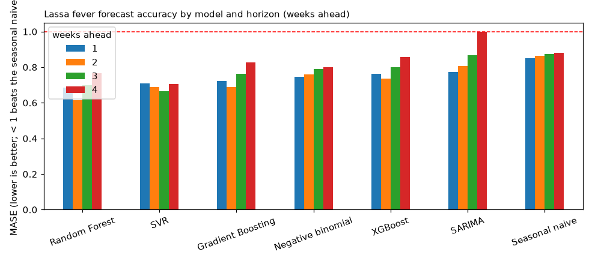

# Results

> ⚠️ **These results come from the SYNTHETIC demo dataset**, generated by the project to show that every part of the pipeline works. They are not real NCDC figures and must not be cited. Rerun this report after loading real data.

Generated automatically by the *Demo results report* workflow. Weeks covered: 04 Jan 2021 – 09 Nov 2026; 10,404 weekly figures for 7 diseases.

## 1. Pipeline runs (RQ1)

| started_at | run_type | status | files_new | rows_extracted | rows_passed | rows_warned | rows_quarantined | revisions_detected | seconds |
|---|---|---|---|---|---|---|---|---|---|
| 2026-11-18 22:38 | manual | success | 13 | 10505 | 10500 | 334 | 5 | 81 | 212 |

## 2. Data quality

Rows held back (quarantine): one deliberately broken row per error rule in the demo.

| rule_code | failure_reason |
|---|---|
| R09_LOCATION | location 'Atlantis' not in the HDX reference list |
| R03_CONFIRMED_LE_SUSP | confirmed (9) > suspected (5) |
| R04_DEATHS_LE_CASES | deaths (3) > confirmed (1) |
| R02_NON_NEGATIVE | suspected is not a whole number: '12.5' |
| R08_EPI_WEEK | 2026-W54 does not exist |

Warnings (row loaded, but flagged):

| flag_type | n |
|---|---|
| R11_TIMELINESS | 334 |

## 3. Revisions detected (RQ2)

81 figures were changed by later reports. First 15:

| disease_name | location | epi_year | epi_week | field_name | old_value | new_value | revision_lag_weeks |
|---|---|---|---|---|---|---|---|
| Lassa fever | Nigeria | 2026 | 33 | suspected | 37 | 50 | 0 |
| Lassa fever | Nigeria | 2026 | 33 | confirmed | 5 | 14 | 0 |
| Lassa fever | Nigeria | 2026 | 33 | deaths | 0 | 2 | 0 |
| Lassa fever | Nigeria | 2026 | 33 | cfr_pct | 0 | 14 | 0 |
| Lassa fever | Bauchi | 2026 | 33 | suspected | 5 | 10 | 0 |
| Lassa fever | Bauchi | 2026 | 33 | confirmed | 0 | 3 | 0 |
| Lassa fever | Bauchi | 2026 | 33 | deaths | 0 | 1 | 0 |
| Lassa fever | Bauchi | 2026 | 33 | cfr_pct |  | 33 | 0 |
| Lassa fever | Edo | 2026 | 33 | suspected | 6 | 11 | 0 |
| Lassa fever | Edo | 2026 | 33 | confirmed | 2 | 5 | 0 |
| Lassa fever | Edo | 2026 | 33 | deaths | 0 | 1 | 0 |
| Lassa fever | Edo | 2026 | 33 | cfr_pct | 0 | 20 | 0 |
| Lassa fever | Ondo | 2026 | 33 | suspected | 15 | 18 | 0 |
| Lassa fever | Ondo | 2026 | 33 | confirmed | 2 | 5 | 0 |
| Lassa fever | Nigeria | 2026 | 34 | suspected | 28 | 36 | 0 |

## 4. Trends (RQ3)

## 5. Outbreak alerts (RQ3)

1230 weeks crossed an alert threshold. Most recent 15:

| method | disease_name | location | week_start | observed | expected | statistic |
|---|---|---|---|---|---|---|
| EARS_C3 | Cholera | Bauchi | 2026-10-19 | 0.0 | 1.6 | 3.4 |
| EARS_C3 | Cholera | Bauchi | 2026-10-12 | 4.0 | 1.4 | 3.4 |
| EARS_C1 | Cholera | Bauchi | 2026-10-05 | 6.0 | 1.6 | 3.9 |
| EARS_C2 | Cholera | Zamfara | 2026-10-05 | 5.0 | 1.1 | 3.9 |
| EARS_C1 | Cholera | Zamfara | 2026-10-05 | 5.0 | 1.3 | 3.7 |
| EARS_C1 | Cholera | Jigawa | 2026-10-05 | 4.0 | 0.4 | 3.6 |
| EARS_C2 | Cholera | Bauchi | 2026-10-05 | 6.0 | 1.6 | 3.2 |
| EARS_C1 | Cholera | Nigeria | 2026-10-05 | 23.0 | 12.6 | 3.1 |
| SARIMA_RESID_Z | Mpox | Nigeria | 2026-10-05 | 13.0 | 4.6 | 2.5 |
| EARS_C3 | Yellow fever | Nigeria | 2026-09-28 | 3.0 | 1.4 | 5.6 |
| EARS_C3 | Yellow fever | Nigeria | 2026-09-21 | 4.0 | 1.1 | 5.3 |
| EARS_C2 | Yellow fever | Nigeria | 2026-09-14 | 5.0 | 0.9 | 4.1 |
| EARS_C3 | Yellow fever | Nigeria | 2026-09-14 | 5.0 | 0.9 | 3.9 |
| EARS_C1 | Yellow fever | Nigeria | 2026-09-14 | 5.0 | 1.4 | 3.6 |
| SARIMA_RESID_Z | Yellow fever | Nigeria | 2026-09-14 | 5.0 | 1.2 | 2.7 |

## 6. Lassa fever forecasting (RQ4)

Rolling-origin evaluation over 55 forecast origins. Best 1-week model: **Random Forest**.

| model | MASE 1 wk | MASE 2 wk | MASE 3 wk | MASE 4 wk |
|---|---|---|---|---|
| Random Forest | 0.686 | 0.616 | 0.700 | 0.766 |
| SVR | 0.709 | 0.688 | 0.666 | 0.707 |
| Gradient Boosting | 0.723 | 0.688 | 0.764 | 0.828 |
| Negative binomial | 0.747 | 0.759 | 0.789 | 0.800 |
| XGBoost | 0.765 | 0.737 | 0.799 | 0.858 |
| SARIMA | 0.774 | 0.808 | 0.867 | 1.000 |
| Seasonal naive | 0.850 | 0.865 | 0.873 | 0.881 |

Diebold-Mariano test against SARIMA, 1 week ahead (negative = more accurate than SARIMA; p < 0.05 = significant):

| model_name | mae | rmse | mase | dm_statistic | dm_p_value |
|---|---|---|---|---|---|
| Gradient Boosting | 6.326 | 9.084 | 0.723 | -0.594 | 0.555 |
| Negative binomial | 6.535 | 8.722 | 0.747 | -0.860 | 0.394 |
| Random Forest | 6.005 | 8.740 | 0.686 | -0.721 | 0.474 |
| Seasonal naive | 7.436 | 11.617 | 0.850 | 0.798 | 0.428 |
| SVR | 6.211 | 8.463 | 0.709 | -0.891 | 0.377 |
| XGBoost | 6.692 | 9.460 | 0.765 | -0.156 | 0.877 |

